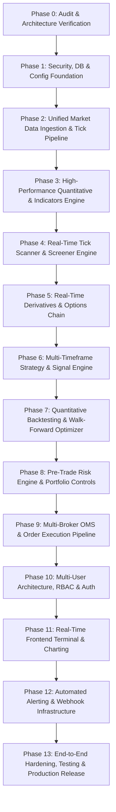

# IMPLEMENTATION ROADMAP — ALGO ROBOT
**Production-Grade Multi-Asset Algorithmic Trading Platform**
**Branch:** `feat-master-algo-platform`  
**Architecture:** Next.js 16 + FastAPI + PostgreSQL/TimescaleDB + Redis + Multi-Broker WebSocket Feeds  

---

## Roadmap Overview

This roadmap defines the strict, phase-by-phase execution plan for transforming ALGO ROBOT into a production-ready, real-data-driven algorithmic trading platform. Each phase is independent, verifiable, and builds upon the preceding layer without breaking existing features.

---

## Phase Details & Deliverables

### Phase 0: Complete Repository Audit & Foundation Planning *(Status: Completed)*
- **Objective:** Deep audit of all 14 pages, 19 UI components, 36 backend modules, and deduplicated 183-company universe.
- **Deliverables:**
  - `PROJECT_AUDIT_REPORT.md`
  - `IMPLEMENTATION_ROADMAP.md`
  - Verification of development branch `feat-master-algo-platform`.

---

### Phase 1: Environment, Security, Configuration & Database Foundation
- **Objective:** Establish production-grade configuration, encrypt sensitive credentials, prevent SSRF, and introduce PostgreSQL/TimescaleDB + Redis.
- **Key Tasks:**
  1. Create structured `.env.example` with strict typing via Pydantic Settings (`backend/app/config.py`).
  2. Implement `EncryptionService` (AES-256-GCM) for broker secrets, TOTP seeds, and API keys.
  3. Replace file-based JSON state ledgers with PostgreSQL database models (SQLAlchemy 2.0 / Alembic migrations).
  4. Integrate Redis for shared in-memory caching, pub/sub tick distribution, and distributed lock management.
  5. Implement SSRF validator for user-entered webhooks.
- **Exact Files Modified / Created:**
  - `backend/app/config.py` (New / Enhanced)
  - `backend/app/core/security.py` (New)
  - `backend/app/db/session.py` (New)
  - `backend/app/db/models.py` (New)
  - `backend/app/db/migrations/` (New Alembic setup)
  - `backend/app/core/redis_client.py` (New)
  - `.env.example` (Updated)
- **Verification Criteria:**
  - Environment variables validate cleanly on startup.
  - Credential encryption/decryption roundtrip unit tests pass.
  - PostgreSQL tables created cleanly with foreign key constraints.
  - Redis connection verified with pub/sub ping-pong.

---

### Phase 2: Unified Market Data Ingestion & Real Tick Pipeline
- **Objective:** Replace synthetic fallback data with genuine, normalized, multi-source streaming feeds from licensed broker WebSockets (Zerodha, Angel One, Upstox, Dhan).
- **Key Tasks:**
  1. Build `BaseBrokerFeedAdapter` interface defining `connect()`, `subscribe(tokens)`, `unsubscribe()`, `on_tick()`.
  2. Implement concrete streaming adapters:
     - `ZerodhaKiteTickerAdapter`
     - `AngelOneSmartStreamAdapter`
     - `UpstoxWebSocketAdapter`
     - `DhanWebSocketAdapter`
  3. Build `MarketDataRouter` with auto-failover: Primary broker stream -> Secondary broker stream -> Graceful degradation to explicit `UNAVAILABLE` / `STALE` status.
  4. Upgrade `tick_engine.py` to stream normalized ticks into Redis Streams and broadcast to frontend `/ws/ticks`.
  5. Enforce **Rule 1**: Discard any random or simulated price generators in production mode.
- **Exact Files Modified / Created:**
  - `backend/app/market_data/base_adapter.py` (New)
  - `backend/app/market_data/kite_adapter.py` (New)
  - `backend/app/market_data/angel_adapter.py` (New)
  - `backend/app/market_data/upstox_adapter.py` (New)
  - `backend/app/market_data/router.py` (New)
  - `backend/app/tick_engine.py` (Refactored to eliminate mock generators)
- **Verification Criteria:**
  - Live ticks streamed from active broker connection.
  - When broker stream is disconnected, API returns `{ status: "UNAVAILABLE", reason: "DISCONNECTED" }` with zero mock prices.
  - WebSocket throughput benchmarked at >2,000 ticks/sec with <5ms latency.

---

### Phase 3: High-Performance Quantitative & Indicators Engine
- **Objective:** Implement vectorized, sub-millisecond technical analysis and institutional Smart Money Concept (SMC) calculations.
- **Key Tasks:**
  1. Build high-speed vectorized indicators (EMA, SMA, Supertrend, RSI, MACD, Bollinger Bands, ATR, VWAP, ADX).
  2. Integrate incremental streaming candle aggregator (1s, 1m, 5m, 15m, 1h, 1d) with real-time updates on every tick.
  3. Enhance `order_block_engine.py` with multi-timeframe Order Block identification, Fair Value Gap (FVG) detection, and Liquidity Sweep tracking.
  4. Benchmark indicator calculation to ensure <2ms execution time per 1,000 candles.
- **Exact Files Modified / Created:**
  - `backend/app/indicators/technical.py` (New / Refactored)
  - `backend/app/indicators/candle_aggregator.py` (New)
  - `backend/app/order_block_engine.py` (Refactored & Vectorized)
- **Verification Criteria:**
  - Unit tests validating calculations against standard TA-Lib values with <0.001% tolerance.
  - Real-time candle builder correctly rolls ticks into OHLCV bars without dropped volume.

---

### Phase 4: Real-Time Tick Scanner & Screener Engine
- **Objective:** Sub-second multi-condition market scanner across the 183 deduplicated companies and 15 sectors.
- **Key Tasks:**
  1. Build flexible scanner condition engine supporting boolean logic (e.g., `Price > VWAP AND RSI > 60 AND Volume > 2 * Volume_MA20`).
  2. Optimize 52-Week High/Low screener (`week52_engine.py`) to run continuously on real-time tick streams.
  3. Build real-time Sector Flow and Market Breadth calculation engine.
  4. Expose WebSocket feed for dynamic scanner results (`/ws/scanner`).
- **Exact Files Modified / Created:**
  - `backend/app/scanner/condition_evaluator.py` (New)
  - `backend/app/scanner/market_scanner.py` (New)
  - `backend/app/week52_engine.py` (Refactored for streaming)
  - `backend/app/market_heatmap_engine.py` (Refactored)
- **Verification Criteria:**
  - Scanner updates 183 stocks within 50ms upon arrival of market-wide tick batch.
  - Zero false positives on 52-week breakout notifications.

---

### Phase 5: Real-Time Derivatives & Advanced Options Chain
- **Objective:** Institutional derivatives analytics with Black-Scholes Greeks, IV skew, and historical Open Interest (OI) buildup.
- **Key Tasks:**
  1. Implement Black-Scholes / Bjerksund-Stensland option pricing engine for real-time Delta, Gamma, Theta, Vega, and Rho.
  2. Compute implied volatility (IV) using Newton-Raphson / Brent root-finding method.
  3. Build multi-strike Open Interest buildup engine: Long Buildup, Short Buildup, Long Unwinding, Short Covering.
  4. Real-time Max Pain and Put-Call Ratio (PCR) calculators.
  5. Multi-strike options chain WebSocket endpoint (`/ws/options/{index_or_symbol}`).
- **Exact Files Modified / Created:**
  - `backend/app/derivatives/black_scholes.py` (New)
  - `backend/app/derivatives/greeks_engine.py` (New)
  - `backend/app/derivatives/oi_analyzer.py` (New)
  - `backend/app/options_engine.py` (Refactored)
  - `frontend/src/app/option-chain/page.tsx` (Connected to live WebSocket)
- **Verification Criteria:**
  - Greeks calculation verified against QuantLib benchmark within 0.0001 precision.
  - Sub-second updates for Nifty, BankNifty, FinNifty, and Sensex option chains.

---

### Phase 6: Multi-Timeframe Strategy & Signal Engine
- **Objective:** Deterministic, rule-based signal generator and full trade lifecycle manager.
- **Key Tasks:**
  1. Implement multi-timeframe signal confirmation (e.g., 15m trend filter + 5m entry trigger + 1m execution check).
  2. Build strategy rule catalog:
     - Momentum Trend Following (Supertrend + VWAP)
     - Mean Reversion (RSI Extreme + Bollinger Band)
     - Breakout & Volume Expansion
     - Smart Money Order Block & FVG Retest
     - Options Selling (Short Straddle / Strangle with Delta Hedging)
  3. Migrate `signals_lifecycle_manager.py` state to PostgreSQL with atomic state transitions: `PENDING` -> `ACTIVE` -> `TARGET_HIT` / `STOP_LOSS_HIT` / `EXPIRED`.
- **Exact Files Modified / Created:**
  - `backend/app/strategies/base_strategy.py` (New)
  - `backend/app/strategies/order_block_strategy.py` (New)
  - `backend/app/strategies/momentum_strategy.py` (New)
  - `backend/app/signals_engine.py` (Refactored)
  - `backend/app/signals_lifecycle_manager.py` (PostgreSQL-backed)
- **Verification Criteria:**
  - State machine transition tests pass with zero dangling or race conditions.
  - Zero synthetic signals generated; all signals trace directly to verifiable tick sequences.

---

### Phase 7: Quantitative Backtesting & Walk-Forward Optimizer
- **Objective:** Institutional-grade backtesting engine with realistic transaction costs, slippage, and walk-forward optimization.
- **Key Tasks:**
  1. Build event-driven and vectorized backtester supporting historical tick and 1-minute OHLCV data.
  2. Implement realistic Indian market friction model:
     - Brokerage (₹20 per order or 0.03%)
     - Securities Transaction Tax (STT / CTT)
     - Exchange Transaction Charges (NSE/BSE)
     - GST (18% on brokerage & transaction charges)
     - SEBI Turnover Fees & Stamp Duty
     - Bid-Ask spread and market impact slippage simulation.
  3. Generate comprehensive performance analytics: CAGR, Sharpe Ratio, Sortino Ratio, Max Drawdown, Calmar Ratio, Profit Factor, Win/Loss ratio.
  4. Implement Walk-Forward Analysis and Monte Carlo simulation.
- **Exact Files Modified / Created:**
  - `backend/app/backtesting/engine.py` (New)
  - `backend/app/backtesting/costs_model.py` (New Indian friction model)
  - `backend/app/backtesting/metrics.py` (New)
  - `backend/app/backtesting/monte_carlo.py` (New)
  - `backend/app/backtest_engine.py` (Upgraded)
  - `frontend/src/app/strategy/page.tsx` (Enhanced backtesting UI)
- **Verification Criteria:**
  - Backtest results accurately deduct all regulatory taxes and realistic slippage.
  - Benchmark against reference strategy outputs with 100% mathematical match.

---

### Phase 8: Pre-Trade Risk Engine & Portfolio Controls
- **Objective:** Rigorous risk safeguards preventing catastrophic drawdown, fat-finger errors, and unauthorized trades.
- **Key Tasks:**
  1. Implement pre-trade validation gatekeeper in `risk_engine.py`:
     - Maximum capital per trade (percentage or absolute amount).
     - Daily maximum loss circuit breaker (hard stop on all trading).
     - Maximum open positions and instrument exposure caps.
     - Fat-finger price band and maximum order quantity limits.
     - Cooldown period after consecutive losing trades.
  2. Real-time portfolio Greeks and delta-neutral monitoring.
- **Exact Files Modified / Created:**
  - `backend/app/risk/pre_trade_validator.py` (New)
  - `backend/app/risk/circuit_breaker.py` (New)
  - `backend/app/risk_engine.py` (Upgraded)
- **Verification Criteria:**
  - Orders exceeding risk limits are rejected in <1ms with explicit rejection reasons.
  - Hitting daily drawdown threshold immediately disables automated order execution.

---

### Phase 9: Multi-Broker OMS & Order Execution Pipeline
- **Objective:** Complete Order Management System supporting Paper Trading and live broker routing.
- **Key Tasks:**
  1. Implement `BaseBrokerOMS` interface for:
     - `place_order()`, `modify_order()`, `cancel_order()`, `get_positions()`, `get_order_book()`, `get_margins()`.
  2. Implement concrete broker execution adapters:
     - Zerodha Kite Connect
     - Angel One SmartAPI
     - Upstox API V2
     - Dhan HQ API
     - Finvasia Shoonya API
  3. Implement **Paper Trading Engine** mimicking exact broker order states (`SUBMITTED`, `OPEN`, `COMPLETE`, `REJECTED`, `CANCELLED`) with real-time fill simulation against actual market ticks.
- **Exact Files Modified / Created:**
  - `backend/app/oms/base_oms.py` (New)
  - `backend/app/oms/paper_trading_engine.py` (New)
  - `backend/app/oms/kite_oms.py` (New)
  - `backend/app/oms/angel_oms.py` (New)
  - `backend/app/oms/upstox_oms.py` (New)
  - `backend/app/broker_manager.py` (Refactored)
  - `frontend/src/app/broker/page.tsx` (Interactive connection testing)
- **Verification Criteria:**
  - Order state machine manages order lifecycle with full idempotency.
  - Paper trading fills execute strictly against real incoming ticks at actual Bid/Ask prices.

---

### Phase 10: Multi-User Architecture, RBAC & Authentication
- **Objective:** Secure multi-tenant architecture with JWT authentication, role-based access control, and tenant data isolation.
- **Key Tasks:**
  1. User authentication system: JWT access & refresh tokens, password hashing (Argon2 / bcrypt).
  2. Multi-tenant database schema: User isolation across strategies, broker accounts, orders, and trade history.
  3. Role-Based Access Control (Admin, Trader, Viewer).
  4. Audit logging of all critical actions (order placement, risk override, credential updates).
- **Exact Files Modified / Created:**
  - `backend/app/auth/jwt_handler.py` (New)
  - `backend/app/auth/dependencies.py` (New)
  - `backend/app/auth/routes.py` (New)
  - `frontend/src/context/AuthContext.tsx` (New)
- **Verification Criteria:**
  - Cross-tenant data leaks impossible; all queries enforce `user_id` filtering.
  - Protected endpoints reject unauthenticated or expired tokens.

---

### Phase 11: Real-Time Frontend Terminal & Charting Integration
- **Objective:** Polish frontend into an institutional trading terminal with sub-second WebSocket updates and responsive views.
- **Key Tasks:**
  1. Unify WebSocket client in frontend with automatic heartbeat, reconnect backoff, and channel multiplexing.
  2. Integrate TradingView Lightweight Charts with custom overlays:
     - Order Block zones (Bullish green, Bearish red)
     - Fair Value Gaps (FVG)
     - Real-time VWAP and Supertrend overlays
  3. Ensure all 14 pages are 100% responsive across desktop, laptop, tablet, and mobile.
  4. Ensure zero UI truncation across all tables and modals.
- **Exact Files Modified / Created:**
  - `frontend/src/services/websocket.ts` (New / Refactored)
  - `frontend/src/components/LightweightChartComponent.tsx` (New)
  - `frontend/src/app/order-block/page.tsx` (Integrated)
  - `frontend/src/app/chart/page.tsx` (Integrated)
- **Verification Criteria:**
  - Zero hydration errors, clean TypeScript build (`tsc --noEmit`).
  - Chrome browser testing confirms smooth 60fps rendering during high-frequency tick bursts.

---

### Phase 12: Automated Alerting & Webhook Infrastructure
- **Objective:** Institutional alerting across Telegram, WhatsApp, Discord, Email, and signed Webhooks.
- **Key Tasks:**
  1. Outbound alert dispatcher with rate limiting and queue management.
  2. Implement secure Webhook delivery with HMAC-SHA256 signature verification.
  3. SSRF-safe URL resolution (prevent calls to loopback and private subnets).
  4. Configurable notification triggers (Signal Created, Order Filled, SL Hit, Daily Risk Warning).
- **Exact Files Modified / Created:**
  - `backend/app/notifications/dispatcher.py` (New)
  - `backend/app/notifications/telegram_service.py` (New)
  - `backend/app/notifications/webhook_service.py` (New)
- **Verification Criteria:**
  - SSRF test blocks attempts to hit `127.0.0.1`, `localhost`, and `169.254.169.254`.
  - Telegram alert arrives within 500ms of signal generation.

---

### Phase 13: End-to-End Hardening, Testing & Production Release
- **Objective:** Complete automated test suite, load testing, security review, and final release.
- **Key Tasks:**
  1. Complete end-to-end integration test suite covering the full trading pipeline:
     - Market Tick -> Indicator Update -> Signal Fire -> Risk Check -> OMS Order -> Trade Ledger Record.
  2. High-load stress testing (10,000 simulated ticks/sec, 100 concurrent WebSocket clients).
  3. Chrome CDP browser test across all 14 pages.
  4. Comprehensive API documentation via OpenAPI/Swagger.
  5. Merge `feat-master-algo-platform` into `main` after complete verification.
- **Exact Files Modified / Created:**
  - `backend/tests/` (Full pytest suite)
  - `DEPLOYMENT_GUIDE.md` (New)
  - `CHANGELOG.md` (New)
- **Verification Criteria:**
  - 100% tests pass.
  - 0 TypeScript errors.
  - Verified live execution in paper trading mode with real market feeds.

---

## Roadmap Sign-Off

This roadmap establishes the complete engineering trajectory for ALGO ROBOT. Development strictly follows this sequence to ensure zero disruption to existing features and absolute data integrity.
