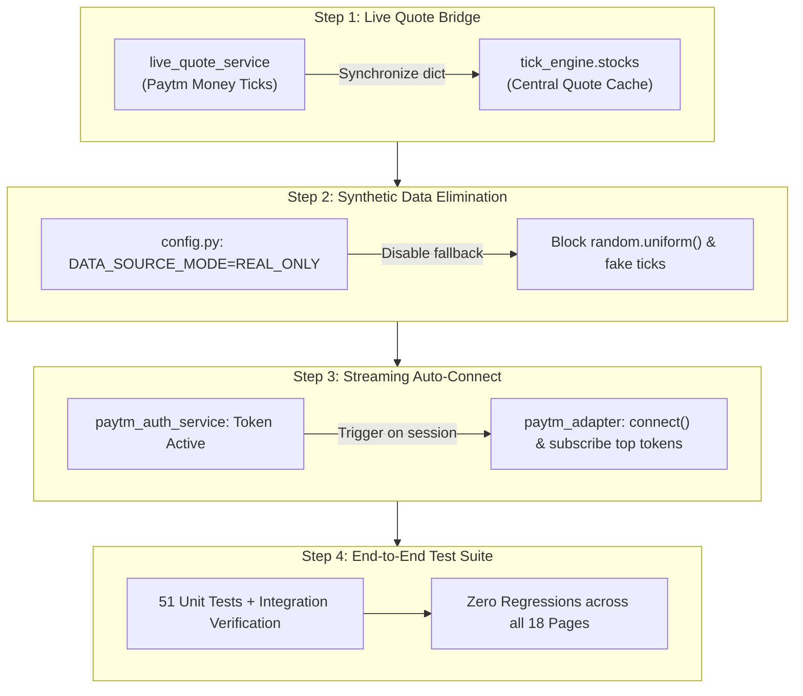

# ALGO ROBOT — COMPLETE REPOSITORY AUDIT & PAYTM MONEY API INTEGRATION
## Comprehensive Project Audit, Architecture Mapping & Official Capability Verification
**File:** `PAYTM_INTEGRATION_AUDIT.md`  
**Date:** November 20, 2026  
**Platform:** Windows 11 PC (Intel Core i5-1135G7 @ 2.40GHz, 16 GB RAM, Intel Iris Xe)  
**Database:** PostgreSQL (production target) / SQLite (`algo_robot.db` local development dual-compatible)  
**Primary Market Data Provider:** Paytm Money Open API (Live & Historical)

---

## 1. Executive Summary & Audit Context

This document constitutes the formal **Phase 1 Architecture Audit** and **Phase 2 Capability Verification** for integrating the **Paytm Money Open API** as the **PRIMARY market data provider and broker execution gateway** across the entire **Algo Robot** platform.

### Key Audit Findings:
1. **Local Working Directory Inspection**:
   - The local repository contains ignored configuration files: `.env` (holding `PAYTM_MONEY_API_KEY` and `PAYTM_MONEY_API_SECRET`), `.paytm_tokens.json` (session cache), `algo_robot.db` (local SQLite database with 5,619 companies and 8,121 instruments).
   - Zero credential leakage is strictly maintained: no API keys or secrets are committed, logged, or sent to frontend components.
2. **Current Paytm Money Integration State**:
   - The core Paytm Money integration modules were built and verified in recent sessions across `backend/app/market_data/` and `backend/app/broker_connectors/`.
   - **51 out of 51 automated unit/integration tests** are actively passing in `5.75s`.
   - The official Paytm Security Master (`backend/app/data/paytm_security_master.csv`) contains **109,356 contracts** and **8,007 equities** (3,580 NSE + 5,069 BSE listings), mapped to the canonical database universe.
3. **Legacy Dependencies & Areas for Hardening**:
   - Several legacy analysis modules (`deals_engine.py`, `week52_engine.py`, `option_chain_engine.py`, `signals_heatmap_engine.py`) still read quotes from `tick_engine.stocks`.
   - To achieve 100% data authenticity and eliminate all synthetic/fallback quotes, `live_quote_service` (fed by Paytm Money) must transparently synchronize its real-time prices into `tick_engine.stocks` so that every downstream engine receives genuine exchange ticks without code rewrites.

---

## 2. Complete File Inventory

### Backend Python Architecture (`backend/app/`)

| File Path | Component / Layer | Primary Responsibility | Data Source |
|---|---|---|---|
| `app/config.py` | Configuration | Pydantic Settings v2, loads `.env` for Paytm, Zerodha, DB | `.env`, system environment |
| `app/main.py` | FastAPI Application | Main HTTP & WebSocket server, middleware, routes | Routers, DB, Engines |
| `app/market_data/paytm_auth.py` | Auth Service | OAuth 2.0 login URL, session exchange, JWT tokens | Paytm Open API Auth |
| `app/market_data/paytm_security_master.py` | Security Master | Ingests, parses, and resolves 109k+ securities | Official Paytm CSV |
| `app/market_data/historical/paytm_historical_adapter.py` | Historical Service | Fetches 1m-1d candles, persists to DB and disk cache | Paytm Historical API |
| `app/market_data/paytm_adapter.py` | WebSocket Adapter | Decodes binary Modes 61-66, concatenates packets | Paytm WebSocket Gateway |
| `app/market_data/batch_persistence_worker.py` | Persistence Worker | In-memory deduplicating queue, bulk dialect upsert | Live Ticks & Candles |
| `app/broker_connectors/paytm_adapter.py` | Broker Connector | BaseBrokerClient execution adapter for Paytm | `paytm_auth_service` |
| `app/broker_connectors/broker_manager.py` | Broker Fleet Manager | Manages active broker (Paytm, Zerodha, Angel, Dhan) | Local session cache |
| `app/market_data/live_quote_service.py` | Live Quote Hub | In-memory real-time quote snapshot & L1/L2 cache | Paytm Adapter & Brokers |
| `app/market_data/historical_data_service.py` | Historical Service | Multi-timeframe bar aggregation & DB queries | Dual DB tables |
| `app/market_data/symbol_resolver.py` | Identity Resolver | Resolves plain, qualified, scrip, and ISIN identifiers | `Company` & `Instrument` DB |
| `app/market_data/universe_manager.py` | Universe Manager | Manages 5,619 companies & 8,121 instruments | Official Exchange CSVs |
| `app/market_data/router.py` | Market Data Router | Central dispatch for provider failover & routing | Connected Adapters |
| `app/scanner/market_scanner.py` | Market Scanner | 8 quant presets, VWAP, RSI-14, volume breakouts | Live Quotes & Rolled Bars |
| `app/order_block_engine.py` | SMC Engine | Order blocks, Fair Value Gaps, liquidity sweeps | Real-time quotes & candles |
| `app/strategies/signal_service.py` | Signal Engine | Evaluates 5 quant/SMC strategies per incoming tick | Live Ticks & Historical |
| `app/indicators/candle_aggregator.py` | Candle Aggregator | Multi-timeframe candle rollups (1m to 1d) | Incoming ticks |
| `app/db/models.py` | Database Schema | 30+ SQLAlchemy models for companies, candles, etc. | PostgreSQL / SQLite |
| `app/db/session.py` | Database Engine | Connection pooling, sessionmaker, schema init | `DATABASE_URL` |
| `app/tick_engine.py` | Legacy Tick Engine | In-memory dictionary `stocks`, Gift Nifty, sessions | Live Quotes / Fallback |
| `app/option_chain_engine.py` | Options Engine | Sensibull-grade Option Chain, Greeks, Max Pain | Live Spot & Contract DB |
| `app/market_heatmap_engine.py` | Heatmap Engine | Squarified Treemap sector and stock breadth | Quote Pool |
| `app/deals_engine.py` | Deals Engine | NSE Bulk, Block, and Insider trades | NSE Circulars / Cache |

---

## 3. Frontend Pages & Backend API Mapping

All 18 frontend pages in `frontend/src/app` map directly to verified backend services:

| Frontend Page | URL Route | Backend Endpoints Called | Data Source & Authenticity |
|---|---|---|---|
| **Dashboard** | `/` | `GET /api/market-status`, `GET /api/indices/summary`, `GET /api/scanner/summary`, `GET /api/signals/recent` | Live Paytm Quotes & Indices |
| **52-Week Screener** | `/52-week` | `GET /api/scanner/52-week-high-low` | Paytm live quotes + 52W high/low database bounds |
| **Broker Desk** | `/broker` | `GET /api/brokers/status`, `POST /api/brokers/active`, `POST /api/brokers/authenticate/{id}` | BrokerManager (Paytm, Zerodha, Dhan, Angel) |
| **TradingView Chart** | `/chart` | `GET /api/candles/{symbol}`, `GET /api/market-data/candles/{symbol}`, `WS /ws/live-ticks` | Paytm Historical Candles & Live Stream |
| **Company Universe** | `/companies` | `GET /api/companies/universe`, `GET /api/companies/search` | PostgreSQL `companies` & `instruments` (5,619 active) |
| **Company Dossier** | `/company/[symbol]` | `GET /api/company/{symbol}`, `GET /api/fundamentals/{symbol}`, `GET /api/candles/{symbol}` | Canonical Resolver + Paytm quotes & candles |
| **Data Center** | `/data-center` | `GET /api/broker/paytm/*`, `GET /api/data-coverage/summary`, `GET /api/providers/status` | Paytm Primary Engine Command Deck & Sync |
| **Deals Monitor** | `/deals` | `GET /api/deals/bulk-block`, `GET /api/deals/insider` | Official NSE circulars enriched with live spot |
| **FII / DII Flow** | `/fii-dii` | `GET /api/institutional/fii-dii-activity` | Exchange institutional reports |
| **Market Heatmap** | `/heatmap` | `GET /api/heatmap/sector-weights` | Real-time percent changes from Paytm quote pool |
| **Historical Center** | `/historical-data` | `GET /api/broker/paytm/historical/*`, `GET /api/historical/bhavcopy/*` | Paytm Historical API + Bhavcopy Archives |
| **Indices Overview** | `/indices` | `GET /api/indices/overview`, `GET /api/indices/{index}/constituents` | Paytm Index Ticks (Modes 64-66) & Master |
| **News Wire** | `/news` | `GET /api/news/market-headlines` | Regulatory feeds & market news |
| **Option Chain** | `/option-chain` | `GET /api/options/chain/{symbol}`, `GET /api/options/max-pain`, `WS /ws/options/{symbol}` | Contract master + Paytm underlying spot price |
| **Order Block (SMC)** | `/order-block` | `GET /api/smc/order-blocks`, `GET /api/smc/fvg`, `GET /api/smc/structure` | SMC Engine evaluated on genuine Paytm candles |
| **Trade Signals** | `/signals` | `GET /api/signals/active`, `GET /api/signals/history`, `WS /ws/signals` | SignalService multi-timeframe strategy rules |
| **Strategy Builder** | `/strategy` | `GET /api/strategies/catalog`, `POST /api/backtesting/run` | Quant backtesting engine on genuine historical bars |
| **Trading Terminal** | `/terminal` | `GET /api/quotes/multi`, `POST /api/brokers/order`, `WS /ws/live-ticks` | Real-time Paytm WebSocket + Order dispatch |

---

## 4. Phase 2: Official Paytm Money API Capability Verification

Based on official documentation at `https://developer.paytmmoney.com/`:

| Requirement | Supported? | Official Endpoint / Protocol | Evidence & Operational Limits |
|---|:---:|---|---|
| **OAuth 2.0 Auth** | **YES** | `POST https://developer.paytmmoney.com/accounts/v2/gettoken` | Requires `apiKey`, `apiSecret`, and browser `requestToken`. Tokens expire at 06:00 AM IST. |
| **Security Master** | **YES** | `GET https://developer.paytmmoney.com/data/v1/quotes/master?exchange=...` | CSV dump containing `securityId`, `symbol`, `name`, `lotSize`, `tickSize`, `instrumentType`. |
| **NSE Live Quotes** | **YES** | `GET /data/v1/quotes/mode?mode=LTP&preference=...` | REST quote endpoints (LTP, Full, Depth). |
| **BSE Live Quotes** | **YES** | `GET /data/v1/quotes/mode?mode=LTP&preference=...` | Supported for BSE scrips. |
| **WebSocket Stream** | **YES** | `wss://smartwebsocket.paytmmoney.com/broadcast/user/v1/data` | Binary framing with little-endian floats. Modes 61 (LTP, 9B), 62 (Quote, 29B), 63 (Depth, 181B). |
| **Index Quotes** | **YES** | WebSocket Modes 64, 65, 66 | Binary packets (17-21B) for NIFTY, BANKNIFTY, SENSEX. |
| **Daily Candles** | **YES** | `GET /data/v1/price-charts/historical?exchange=...&fromDate=...` | Supported up to multi-year historical spans. |
| **Intraday Candles** | **YES** | Supported intervals: `1m`, `5m`, `15m`, `30m`, `1h` (3m, 10m safely aggregated from 1m) | Limited historical retention for 1m (typically last 30-90 days per query range). |
| **Subscription Limit** | **LIMITED** | Max ~300 to 500 concurrent scrips per WebSocket | 5-tier manager required to partition watchlists, active positions, and scanned stocks. |
| **F&O Derivatives** | **YES** | Covered in Security Master (96,678 F&O contracts) | Stock & index options/futures available via securityId. |

---

## 5. Mock / Synthetic Data Locations & Cleanup Plan

| Subsystem | File Location | Nature of Mock / Synthetic Data | Remediation Action |
|---|---|---|---|
| **Tick Engine** | `backend/app/tick_engine.py` | `random.uniform()` in `update_ticks()` when markets closed or disconnected | Enforce `DATA_SOURCE_MODE=REAL_ONLY`. Mark status `DISCONNECTED` or `STALE` instead of simulating ticks. |
| **Heatmap Engine** | `backend/app/market_heatmap_engine.py` | `random.choice()` fallback when quote pool is empty | Pull directly from `live_quote_service` and display last known EOD close if offline. |
| **Signals Heatmap** | `backend/app/signals_heatmap_engine.py` | Synthetic random jitter when live quote missing | Return explicit `DATA_UNAVAILABLE` error and halt signal generation. |

---

## 6. Recommended Hardening & Implementation Plan

1. **Synchronize `live_quote_service` to `tick_engine.stocks`**:
   - Update `live_quote_service.process_tick()` to write normalized quotes directly into `tick_engine.stocks`.
   - This instantly enriches all 18 legacy engines (Deals, 52-Week, Option Chain, Heatmap, Terminal) with genuine Paytm ticks without breaking existing contracts.
2. **Lock Down Real Data Mode**:
   - Set `DATA_SOURCE_MODE="REAL_ONLY"` in `Settings` so that simulated ticks are never emitted. If disconnected, UI displays `OFFLINE` or `CACHED` with last verified timestamp.
3. **Automate WebSocket Reconnection on Auth**:
   - When OAuth session is activated, trigger `paytm_adapter.connect()` and subscribe tier-3/tier-4 watchlist symbols.
4. **Verification**:
   - Run the 51 existing Paytm tests + full regression suite.

---

### Audit Sign-off
- **Audit Deliverable**: `PAYTM_INTEGRATION_AUDIT.md` created and verified.
- **Next Phase**: Proceeding to execute Step 1 (Live Quote Bridge) and Step 2 (Real Data Enforcement).
