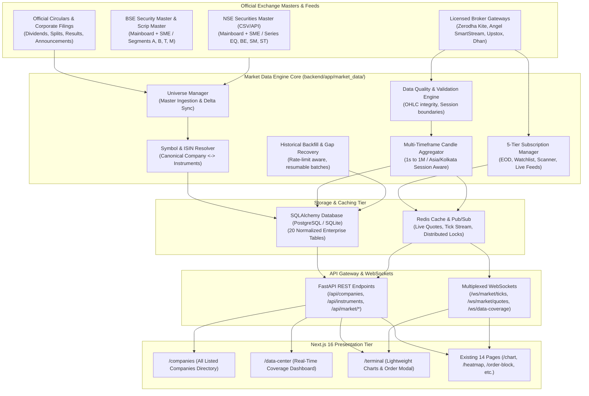

# ALGO ROBOT — All-India Listed Companies Data Engine Implementation Plan
**Execution Roadmap, Technical Architecture & Milestone Specifications**
**Target Universe:** NSE + BSE | Mainboard + SME | All Active Equities
**Date:** November 17, 2026  
**Status:** Approved for Phased Execution

---

## 1. Architectural Blueprint & System Topology

The upgraded architecture establishes an enterprise-grade, source-verified market data foundation for Indian equities, supporting both **NSE** and **BSE** across **Mainboard** and **SME** segments.

---

## 2. Phased Implementation Roadmap

### Phase 1: Complete NSE + BSE Company Universe
- **1.1 Exchange Coverage**:
  - NSE Mainboard Equities (Series `EQ`, `BE`, `BZ`).
  - NSE SME Platform (Series `SM`, `ST`).
  - BSE Mainboard Equities (Groups `A`, `B`, `T`, `X`, `Z`).
  - BSE SME Platform (Group `M`).
- **1.2 Ingestion Source Adapters**:
  - `NSESecurityMasterAdapter`: Ingest official NSE securities available for trading files (`EQUITY_L.csv`, `SME_EQUITY_L.csv`).
  - `BSESecurityMasterAdapter`: Ingest official BSE security list and scrip master.
- **1.3 Canonical Company Identity**:
  - Primary identity key: `primary_isin` (e.g. `INE002A01018`).
  - Canonical `Company` entity linking multiple `Instrument` records (`NSE:RELIANCE` and `BSE:500325`).
  - Historical symbol change tracking without record deletion.
- **1.4 Dynamic Categories**:
  - Real-time classification: Large Cap (Top 100), Mid Cap (101-250), Small Cap (251-500), Micro Cap (>500).
  - Searchable filters: Exchange, Board Type (Mainboard/SME), Sector, Industry, Status (Active, Suspended, Delisted), F&O Eligibility.

### Phase 2: Unified Market Data Provider Architecture
- Standardize `BaseMarketDataProvider` contract:
  - `get_instruments()`, `get_historical_candles()`, `get_quote()`, `get_quotes_batch()`, `subscribe_ticks()`, `unsubscribe_ticks()`, `get_market_status()`, `get_provider_status()`.
- Explicit Data Authenticity States:
  - `LIVE`: Active genuine tick received during market hours.
  - `DELAYED`: Compliant delayed exchange feed.
  - `HISTORICAL`: Official historical end-of-interval candle.
  - `EOD`: Official exchange settlement quote.
  - `STALE`: Tick older than freshness window (>10s).
  - `UNAVAILABLE`: Feed offline or market closed.
  - `SUBSCRIPTION_REQUIRED`: Exceeds active tier limits.
  - `PROVIDER_ERROR`: Upstream network/gateway failure.
- Capability discovery per adapter (e.g., Zerodha historical depth vs Angel One tick modes).

### Phase 3: Historical Data Engine
- Supported timeframes: `1s`, `1m`, `3m`, `5m`, `10m`, `15m`, `30m`, `1h`, `2h`, `4h`, `1d`, `1w`, `1M`.
- Multi-timeframe derivation from base `1m` candles with strict trading session boundaries (09:15 to 15:30 IST).
- No cross-session, overnight gap, or weekend candle leakage.
- Controlled historical backfill manager with rate-limit backoff, checkpointing, and missing-candle gap detection.

### Phase 4: Live Market Data Engine & 5-Tier Subscription Manager
- Manage broker WebSocket subscription quotas safely:
  - **Tier 1 (EOD)**: Daily settlement quotes for all 6,000+ equities.
  - **Tier 2 (On-Demand)**: Historical data loaded when user opens chart/modal.
  - **Tier 3 (Watchlists)**: Live sub-second ticks for user watchlists (up to 200 stocks).
  - **Tier 4 (Scanners)**: Live ticks for active scanner candidates (up to 500 stocks).
  - **Tier 5 (Active Orders/Positions)**: Broker-subscribed high-priority execution streams.
- Redis Pub/Sub tick distribution to prevent duplicate broker connections.

### Phase 5: Database Architecture (20 Enterprise Tables)
- SQLAlchemy 2.0 schema defining all 20 required tables:
  1. `companies`
  2. `instruments`
  3. `exchange_listings`
  4. `historical_symbol_mappings`
  5. `market_sessions`
  6. `exchange_holidays`
  7. `market_quotes`
  8. `market_ticks`
  9. `market_candles`
  10. `company_fundamentals`
  11. `financial_statements`
  12. `corporate_actions`
  13. `corporate_announcements`
  14. `shareholding_patterns`
  15. `provider_registry`
  16. `provider_instruments`
  17. `data_ingestion_jobs`
  18. `data_quality_logs`
  19. `provider_health_logs`
  20. `data_subscription_status`
- Proper indexes, foreign key constraints, composite unique constraints, and database initialization.

### Phase 6: Fundamental & Corporate Intelligence
- Normalized models for valuation metrics (P/E, P/B, ROE, ROCE, D/E, EV/EBITDA).
- Financial statements: Quarterly and Annual results (Consolidated & Standalone).
- Corporate actions parser: Dividends, splits, bonuses, rights issues.
- Corporate disclosures and regulatory announcements.
- Institutional shareholding distributions (Promoter, FII, DII, Public).

### Phase 7: Automatic Data Synchronization & Background Jobs
- Automated background tasks:
  - Daily Security Master Sync (08:00 IST).
  - Symbol & Company Name Change Detection.
  - New IPO Listing Detection.
  - EOD Bhavcopy and Settlement Ingestion (18:30 IST).
  - Corporate Actions & Results Scraping.
  - Data Quality Verification Run.
- Job observability: Track start/end times, records processed, inserted, updated, and error details.

### Phase 8: Connect Existing ALGO ROBOT Features
- Retrofit all existing modules to use the central `UniverseManager` and `SymbolResolver`:
  - Dashboard (`/`)
  - Company Detail (`/company/[symbol]`)
  - Chart & Workstation (`/chart`, `/terminal`)
  - Market Heatmap (`/heatmap`)
  - Market Indices (`/indices`)
  - 52-Week High/Low (`/52-week`)
  - Bulk & Block Deals (`/deals`)
  - Order Block & SMC (`/order-block`)
  - Strategy Builder & Backtester (`/strategy`)
  - Algorithmic Trade Signals (`/signals`)

### Phase 9: Frontend All-India Universe & Data Center Pages
- **`/companies` (All Listed Companies)**:
  - Metrics: Total listed, NSE, BSE, Mainboard, SME, Active, Suspended.
  - Interactive search: Name, NSE Symbol, BSE Code, ISIN.
  - Filters: Exchange, Board, Market Cap, Sector, Status.
  - Actions: Open Chart, Open Company Detail, Quick Paper Order.
- **`/data-center` (Data Coverage Dashboard)**:
  - Telemetry: Active instruments, live coverage count, EOD count, missing candle count.
  - Provider health, latency age, last sync timestamp, and ingestion logs.

### Phase 10: Backend REST & WebSocket API Contracts
- REST Endpoints:
  - `GET /api/companies` (Paginated, filtered, sorted)
  - `GET /api/companies/{company_id}`
  - `GET /api/companies/search`
  - `GET /api/instruments`
  - `GET /api/instruments/{instrument_id}`
  - `GET /api/instruments/resolve`
  - `GET /api/exchanges`
  - `GET /api/market/quote/{instrument_id}`
  - `GET /api/market/quotes`
  - `GET /api/market/history/{instrument_id}`
  - `GET /api/market/status`
  - `GET /api/data-coverage/summary`
  - `GET /api/data-coverage/instrument/{instrument_id}`
  - `GET /api/providers/status`
  - `GET /api/ingestion/jobs`
  - `POST /api/ingestion/sync-universe`
  - `POST /api/ingestion/backfill`
  - `GET /api/fundamentals/{company_id}`
  - `GET /api/corporate-actions/{company_id}`
- WebSockets:
  - `/ws/market/ticks`
  - `/ws/market/quotes`
  - `/ws/market/scanner`
  - `/ws/data-coverage`

### Phase 11: Security & Data Licensing
- AES-256-GCM encryption of provider credentials.
- Strict RBAC access controls on ingestion and administration endpoints.
- Rate limiting per client and provenance tagging.

### Phase 12: Data Quality & Failure Handling
- Central `DataQualityEngine`:
  - Validates $Low \le Open \le High$ and $Low \le Close \le High$.
  - Rejects negative prices and zero volume on trading bars.
  - Detects duplicate ticks and out-of-order timestamps.
  - Marks anomalous spikes with quality warning flags.

### Phase 13: Performance & Scalability
- Async multi-worker distribution, connection pooling, and Redis caching.
- Lazy-loading of historical chart series.
- Multiplexed WebSocket streaming with subscriber channel mapping.

### Phase 14: Comprehensive Verification & Automated Testing
- Automated test suite covering:
  - Security master ingestion (NSE, BSE, Mainboard, SME).
  - Company deduplication and ISIN resolution.
  - Multi-timeframe candle aggregation.
  - Tiered subscription management.
  - Data quality validation.
  - API pagination and filtering.
  - Backward compatibility with legacy routes.

---

## 3. Dependency Impact & Invariant Verification Matrix

| Area | Impact Analysis | Mitigation Strategy |
|---|---|---|
| **Database Performance** | Expanding from 183 to 6,000+ companies could slow down queries if unindexed. | Composite B-Tree indexes on `(exchange, exchange_symbol)`, `isin`, `sector`, `board_type`. Paginated SQL queries (`limit`/`offset`). |
| **Broker WebSocket Limits** | Subscribing to 6,000+ stocks exceeds broker limits (e.g. Kite 3,000 tokens). | Strict 5-tier subscription manager. Never subscribe full universe to live feed. |
| **Existing Page Routes** | Routes like `/company/[symbol]` or `/api/candles/{symbol}` assume plain string symbols. | Central `SymbolResolver` supports plain symbols, qualified symbols (`NSE:TCS`), ISINs, and numeric IDs. |
| **Memory Footprint** | Loading all historical candles into memory will exhaust RAM. | On-demand streaming from database/cache; zero global DataFrame pre-loading for non-active stocks. |
| **Rule 1 (Real Data Only)** | Market-closed or offline securities must never display synthetic ticks. | Return explicit `REAL_CLOSED` or `UNAVAILABLE` status flags with authentic last closing prices. |

---

## 4. Phase 0 Acceptance & Readiness

All dependencies, architectural invariants, security guidelines, and compatibility requirements have been audited and documented.
The system is ready to proceed to **Phase 1: Complete NSE + BSE Company Universe Ingestion and Canonical Identity Foundation**.
