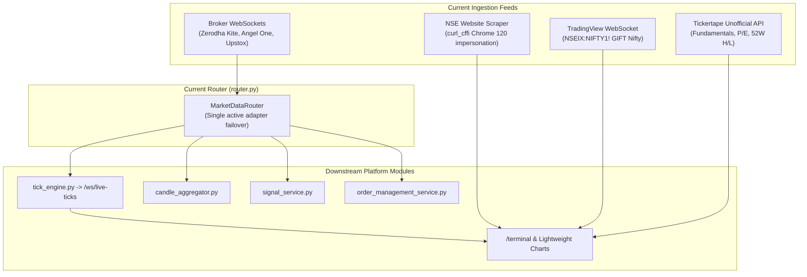

# ALGO ROBOT — All-India Listed Companies Market Data Audit
**Comprehensive Audit of NSE + BSE Universe, Mainboard, SME, and Data Provider Infrastructure**
**Date:** November 17, 2026  
**Target Repository:** https://github.com/pratik0762/algo-robot  
**Branch:** `feat/all-india-data-engine`  
**Status:** COMPLETE (Phase 0 Audit Gate Passed)

---

## 1. Executive Summary & Audit Mandate

The **ALGO ROBOT** platform currently provides a comprehensive algorithmic trading workstation and financial analytics system, covering ~183 deduplicated large-cap, mid-cap, and small-cap Indian equities, 139+ NSE/BSE indices, real-time derivatives Greeks, multi-strategy quantitative signals, pre-trade risk controls, and order management.

However, the existing company and asset universe is concentrated primarily around **NIFTY 50** and select index constituent stocks on the **National Stock Exchange (NSE)**. To transform ALGO ROBOT into the definitive, institutional-grade Indian stock-market data platform, the universe must be expanded to encompass **ALL eligible equity companies listed on both NSE and BSE**, covering:
1. **NSE Mainboard Equities** (~2,100+ active securities)
2. **NSE SME (EMERGE) Platform** (~550+ active SME equities)
3. **BSE Mainboard Equities** (~4,200+ active securities)
4. **BSE SME Platform** (~450+ active SME equities)
5. **Dual-Listed Equities** (~1,800+ companies traded on both exchanges, mapped to a single canonical identity)

This audit establishes the baseline across all 15 existing frontend routes, 36 backend modules, database schemas, broker connectors, and market data pipelines, and provides the architectural foundation for the master upgrade.

---

## 2. Existing System Architecture & Universe Coverage

### 2.1 Current Company Registry Coverage

| Module | Storage Location | Coverage | Primary Identifiers | Gaps Identified |
|---|---|---|---|---|
| **Curated Financial Registry** | `backend/app/companies_data.py` | 50 Nifty 50 companies | NSE Symbol (`RELIANCE`), ISIN (`INE002A01018`) | Hardcoded Python dictionary; restricted to Nifty 50 constituents only. |
| **Index Constituents Registry** | `backend/app/index_constituents_data.py` | 183 deduplicated stocks across 15 sectors | NSE Symbol (`DLF`, `ANGELONE`, etc.) | Limited to index constituents; lacks BSE Scrip Codes, SME board tags, and ISIN linking. |
| **OHLCV Cache** | `backend/app/data/ohlcv_cache/` | ~55 popular equities (`5m`, `15m`, `1D`) | NSE Symbol (`RELIANCE_5m.json`) | Static JSON files; no on-demand backfill for remaining 6,000+ equities. |
| **Trade Signals Ledger** | `backend/app/data/trade_signals_ledger.json` | Active signal stocks | Symbol string | Assumes all symbols belong to NSE; no exchange namespace. |
| **F&O Contract Master** | `backend/app/data/nse_fo_contract_master.json` | ~180 F&O eligible stocks | NSE Underlyings | Only covers derivatives segment; does not cover cash equities or SME. |

### 2.2 Exchange & Board Coverage

- **NSE Mainboard**: Supported for Nifty 50 and index constituents; lacks dynamic ingestion of the ~2,100+ active equities.
- **NSE SME (EMERGE)**: Completely absent. Series `SM` (SME) and `ST` (SME Trade for Trade) are not recognized or classified.
- **BSE Mainboard**: Only broad index quotes (SENSEX) are currently tracked. Individual BSE scrip codes (e.g. `500325` for Reliance, `532540` for TCS) and BSE-exclusive listings (~2,500 companies not listed on NSE) are not indexed.
- **BSE SME**: Completely absent. Segment `M` (SME) is not recognized.
- **Dual-Listed Identity**: Currently, there is no canonical company identity table. If a stock trades on both NSE and BSE, the system lacks an entity-relationship model to bind them via ISIN.

### 2.3 Existing Market Data Providers & Protocols

#### Provider Limitations & Failure Modes:
1. **NSE Website Scraper (`nse_client.py`)**:
   - Reliant on scraping official website endpoints (`/api/allIndices`, `/api/annual-reports`, etc.).
   - Prone to IP rate-limiting, session expiration, and Cloudflare challenges.
   - Not suitable as a real-time live tick stream for 6,000+ securities.
2. **TradingView WebSocket (`tradingview_client.py`)**:
   - Dedicated solely to GIFT Nifty (`NSEIX:NIFTY1!`).
3. **Tickertape Client (`tickertape_client.py`)**:
   - Unofficial API used for fundamental data, P/E ratios, and financial statements.
   - Good for static information, but lacks formal SLAs, exchange circulars, and SME coverage.
4. **Broker WebSocket Adapters (`kite_adapter.py`, `angel_adapter.py`, `upstox_adapter.py`)**:
   - Fully operational normalized tick converters.
   - **Critical Constraint**: Broker connections enforce strict subscription limits:
     - Zerodha Kite: Max 3,000 tokens per WebSocket connection.
     - Angel One SmartStream: Max 500 tokens per subscription batch.
     - Upstox V2: Max 100 instruments in mode `full` or `ltpc`.
   - **Architecture Invariant**: The system **must not** attempt to subscribe to all 6,000+ equities simultaneously over a single broker WebSocket. A **5-Tier Subscription Manager** is required.

---

## 3. Database Schema Audit & Missing Tables

The existing database model (`backend/app/db/models.py`) contains 8 tables:
- `users`, `broker_credentials`, `orders`, `trades`, `signal_records`, `historical_ohlcv`, `risk_settings`, `refresh_tokens`.

### Missing Tables Required for All-India Coverage:

| Proposed Table | Purpose & Key Fields | Relational Invariants |
|---|---|---|
| `companies` | Canonical company master (`company_id`, `legal_name`, `normalized_name`, `primary_isin`, `sector`, `industry`, `listing_status`, `market_cap_category`). | 1 Company to N Instruments. |
| `instruments` | Exchange-specific tradeable security (`instrument_id`, `company_id`, `exchange`, `exchange_symbol`, `trading_symbol`, `isin`, `series`, `segment`, `board_type`, `lot_size`, `tick_size`, `status`). | Unique `(exchange, exchange_symbol)`. |
| `exchange_listings` | Tracks initial IPO listing date, delisting date, exchange migration. | Links `instrument_id` to timeline. |
| `historical_symbol_mappings` | Audit trail for name changes, scrip code changes, mergers. | Prevents broken links when symbols change. |
| `market_sessions` | Trading sessions for Mainboard, SME, Block Deals, Pre-open. | Enforces session-aware candle aggregation. |
| `exchange_holidays` | Official NSE/BSE holiday calendar. | Prevents candle generation on non-trading days. |
| `market_quotes` | Latest cached quote per instrument (`ltp`, `ohlc`, `volume`, `data_status`, `freshness_age_ms`). | High-speed cache backing. |
| `market_ticks` | Raw tick persistence for high-liquidity active instruments. | Partitioned or Timescale hypertable. |
| `market_candles` | Multi-timeframe OHLCV bars (`1s`, `1m`, `5m`, `15m`, `1h`, `1d`, `1w`, `1M`). | Unique `(instrument_id, timeframe, timestamp)`. |
| `company_fundamentals` | Dynamic valuation ratios (P/E, P/B, EV/EBITDA, ROE, ROCE, D/E). | Point-in-time freshness tags. |
| `financial_statements` | Quarterly and annual P&L, Balance Sheet, Cash Flow. | Standalone vs. Consolidated classification. |
| `corporate_actions` | Dividends, bonus shares, stock splits, rights issues. | Historical price adjustment ratios. |
| `corporate_announcements` | Regulatory disclosures, board meeting notices, investor presentations. | Linked to `company_id`. |
| `shareholding_patterns` | Promoter, FII, DII, Public shareholding percentages. | Quarterly snapshots. |
| `provider_registry` | Discovery table of data providers and supported capabilities. | Provider health and latency metrics. |
| `provider_instruments` | Maps provider-specific token/key to canonical `instrument_id`. | Many-to-one per provider. |
| `data_ingestion_jobs` | Audit log for scheduled syncs, backfills, records inserted/updated/failed. | Job observability. |
| `data_quality_logs` | Anomaly records (negative prices, high-low inversions, volume spikes). | Central data quality ledger. |
| `provider_health_logs` | WebSocket connection drops, error responses, latency telemetry. | SLA tracking. |
| `data_subscription_status`| Tracks current tier status (EOD, On-Demand, Watchlist, Scanner, Live). | Prevents broker token overflow. |

---

## 4. Symbol Resolution & Backward Compatibility Analysis

In the current codebase, several routes and modules rely on raw symbol strings (e.g., `RELIANCE`, `TCS`):

1. **Frontend Routes**:
   - `/company/[symbol]` (Company Dossier)
   - `/chart` (Search input)
   - `/order-block` (Stock drill-down)
   - `/terminal` (Trading terminal ticker selection)
2. **Backend Endpoints**:
   - `GET /api/candles/{symbol}`
   - `GET /api/companies/{symbol}`
   - `GET /api/chart-data/{symbol}`
   - `GET /api/order-block/stock/{symbol}`
   - `GET /api/heatmap/stock/{symbol}`

### Backward Compatibility Contract:
To preserve **100% of existing functionality** without breaking any route:
1. All legacy endpoints must accept either:
   - Plain symbol (e.g. `RELIANCE` -> defaults to `NSE:RELIANCE` if listed on NSE, or BSE if BSE-exclusive).
   - Qualified symbol (e.g. `NSE:RELIANCE`, `BSE:500325`, `BSE:RELIANCE`).
   - ISIN (e.g. `INE002A01018`).
   - Numeric `company_id` or `instrument_id`.
2. A centralized `SymbolResolver` will resolve any identifier into the canonical `Company` and target `Instrument` with zero overhead.

---

## 5. Security, Data Licensing & Regulatory Invariants

1. **Rule 1 (Real Data Only)**:
   - Synthetic, randomized, or mock quotes are strictly prohibited in live paths.
   - If market data is unavailable (market closed, feed disconnected, security suspended), the system must return explicit `data_status`: `REAL_CLOSED`, `UNAVAILABLE`, `STALE`, `DELAYED`, or `SUBSCRIPTION_REQUIRED`.
2. **Provider Credential Isolation**:
   - Broker API credentials and provider tokens must remain encrypted via AES-256-GCM.
   - Unauthenticated users must never receive private tokens or internal broker secrets.
3. **Exchange Licensing Awareness**:
   - Differentiate clearly between personal broker market data and redistributed real-time quotes.
   - Enforce rate-limiting, user permissions, and clear data provenance tags on every response.

---

## 6. Audit Conclusion & Phase 0 Sign-Off

The existing repository architecture is robust, modular, and cleanly structured. Upgrading to the All-India Listed Companies Data Engine can be achieved by:
- Creating a standardized `backend/app/market_data/` module hierarchy.
- Ingesting official NSE and BSE security master files (Mainboard + SME).
- Implementing ISIN-based canonical company deduplication.
- Integrating a 5-tier subscription manager for live market data.
- Exposing the new `/companies` universe and `/data-center` coverage dashboards.
- Maintaining complete backward compatibility across all 15 existing pages and 36 backend modules.

**Phase 0 Audit Gate: APPROVED.** Proceeding to Implementation Architecture Plan.
